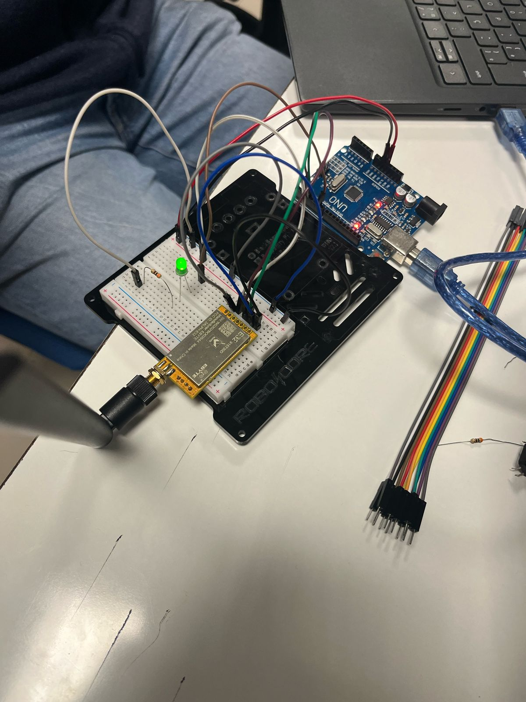
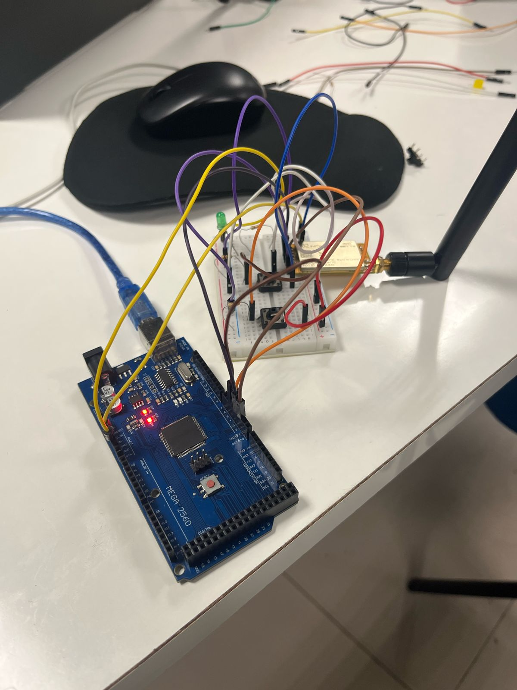
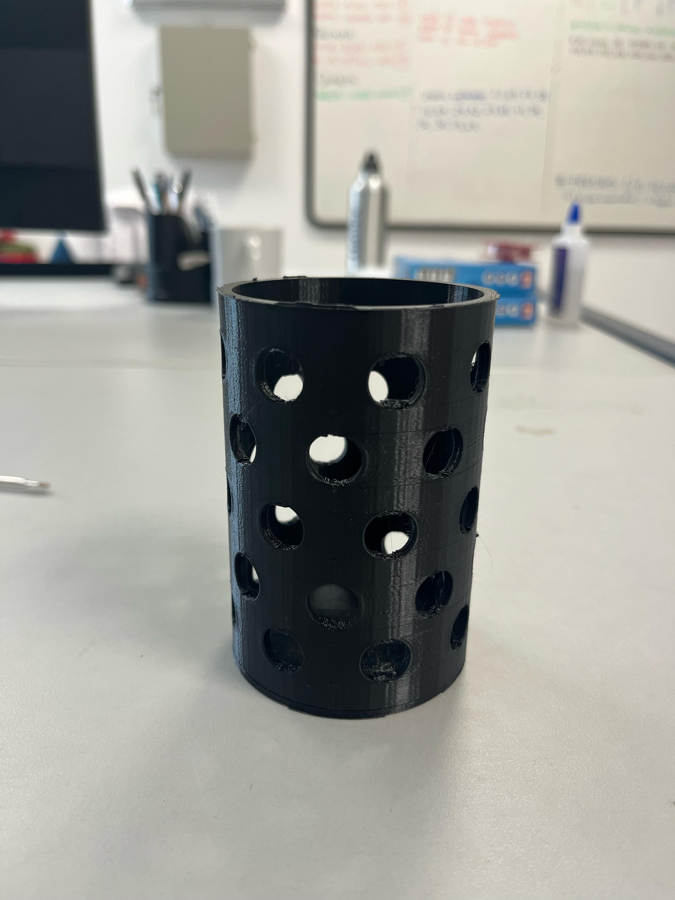

# Projeto de Sistema Embarcado - Comunicação LORA (CANSAT 2025)

## Links
[Overleaf](https://www.overleaf.com/project/67d35431212153aa53f4d6de)
[Apresentação AP2](https://www.canva.com/design/DAGqhZk9VP4/F6xNFaBpqeg8qPPRLxJIvQ/edit?utm_content=DAGqhZk9VP4&utm_campaign=designshare&utm_medium=link2&utm_source=sharebutton)
## Descrição do Projeto
Este projeto consiste na implementação de um sistema de comunicação sem fio utilizando a tecnologia LORA (Long Range), desenvolvido para a disciplina de Projeto de Sistema Embarcado. O objetivo principal é estabelecer uma comunicação eficiente entre um transmissor e um receptor, possibilitando a troca de dados a longa distância com baixo consumo de energia.

## Tecnologias Utilizadas
- Arduino
- Módulos LORA OSOYOO UART
- ESP32
- Mosquitto MQTT Broker
- Sensor Ultrassônico HC-SR04
- Software Arduino IDE
- Impressão 3D para o case dos dispositivos

## Implementação

### Comunicação LORA
Em nossa implementação, utilizamos módulos LORA OSOYOO UART para estabelecer a comunicação sem fio. Após alguns testes iniciais e ajustes, conseguimos com sucesso realizar a transmissão de dados entre o receptor e o transmissor na aula do dia 27/03/2025.

#### Código de Comunicação

#### Teste de Comunicação com Ações (Botões e LED)
O código abaixo foi implementado para estabelecer a comunicação entre os dispositivos:

```cpp
#include <SoftwareSerial.h>

SoftwareSerial mySerial(2, 3); //TX, RX
// (Send and Receive)

void setup() {
  Serial.begin(9600);
  mySerial.begin(9600);
}

void loop() {

  if(Serial.available() > 0){//Read from serial monitor and send over OSOYOO UART LoRa wireless module
    String input = Serial.readString();
    mySerial.println(input);
  }

  if(mySerial.available() > 1){//Read from OSOYOO UART LoRa wireless module and send to serial monitor
    String input = mySerial.readString();
    Serial.println(input);
  }
  delay(20);
}
```

Este código utiliza a biblioteca SoftwareSerial para criar uma porta serial virtual, permitindo a comunicação entre o Arduino e o módulo LORA. O programa monitora constantemente duas entradas:

Após validar a comunicação básica entre os módulos LORA, realizamos um segundo teste utilizando uma abordagem mais próxima da aplicação final. No transmissor, implementamos dois botões: um responsável por enviar o comando "ON" e outro por enviar "OFF". No receptor, um LED indicava visualmente o recebimento desses comandos, acendendo ou apagando conforme o sinal recebido.

Esse teste foi importante para verificar o controle de dispositivos remotos por meio da comunicação LoRa. Abaixo estão os códigos utilizados para o transmissor e o receptor:
1. Dados transmitidos pela porta serial do computador, que são enviados para o módulo LORA
```cpp
#include <SoftwareSerial.h>

#define BTN1  4
#define BTN2  5  

SoftwareSerial loraSerial(2, 3); // TX, RX

String turnOn = "on";
String turnOff = "off";

void setup() {
  pinMode(BTN1, INPUT_PULLUP);
  pinMode(BTN2, INPUT_PULLUP);
  Serial.begin(9600);
  loraSerial.begin(9600);
}

void loop() {
  if(digitalRead(BTN1) == 0) {
    loraSerial.print(turnOn);
    while(digitalRead(BTN1) == 0);
    delay(50);
  }

  if(digitalRead(BTN2) == 0) {
    loraSerial.print(turnOff);
    while(digitalRead(BTN2) == 0);
    delay(50);
  }
}
```

2. Dados recebidos pelo módulo LORA, que são enviados para a porta serial do computador
```cpp
#include <SoftwareSerial.h>

#define LED1  4  

SoftwareSerial loraSerial(2, 3); // TX, RX

void setup() {
  pinMode(LED1, OUTPUT);
  Serial.begin(9600);
  loraSerial.begin(9600);  
}

void loop() { 
  if(loraSerial.available() > 1){
    String input = loraSerial.readString();
    Serial.println(input);  
    if(input == "on") {
      digitalWrite(LED1, HIGH);  
    } 
    if(input == "off") {
      digitalWrite(LED1, LOW);
    }
  }
  delay(20);
}
```

### Implementação do MQTT com ESP32
Em nossos testes realizados em 02/04/2025, implementamos o protocolo MQTT utilizando o ESP32 como dispositivo base. O MQTT (Message Queuing Telemetry Transport) será utilizado em conjunto com a tecnologia LORA para fornecer uma comunicação robusta e eficiente para nosso projeto CANSAT.

#### Etapas de Testes com MQTT

1. **Teste com ESP32 e Sensor Ultrassônico**
   
   Inicialmente realizamos a integração do sensor ultrassônico HC-SR04 com o ESP32 para validar a leitura de dados do sensor. Este teste foi fundamental para garantir que os dados coletados estivessem corretos antes de implementar a comunicação MQTT.

2. **Teste MQTT Local**
   
   Após validar o funcionamento do sensor, configuramos um broker MQTT local para testar a comunicação. Utilizamos o Mosquitto como broker MQTT e verificamos a transmissão e recebimento de mensagens entre o computador local e o dominio público test.mosquitto.org.

3. **Teste MQTT com Broker Público**
   
   Em seguida, realizamos testes de conectividade com o broker público test.mosquitto.org. Durante esta etapa, encontramos um obstáculo: a rede Wi-Fi do IBMEC (onde os testes foram realizados) provavelmente bloqueia as conexões MQTT. Para contornar esse problema, conectamos o ESP32 à rede de dados móveis de um celular, obtendo sucesso na comunicação.
   
   ```cpp
    #include <WiFi.h>
    #include <PubSubClient.h>
    
    const char* ssid = "IPhone de Michel";  // Substitua pelo nome da sua rede Wi-Fi
    const char* password = "iphone-michel";  // Substitua pela senha do Wi-Fi
    
    // Configuração MQTT
    const char* mqtt_server = "test.mosquitto.org";  // Servidor MQTT público
    const int mqtt_port = 1883;  // Porta padrão MQTT
    const char* mqtt_topic = "iotbr/esp32";  // Tópico MQTT onde vamos publicar
    
    WiFiClient espClient;
    PubSubClient client(espClient);
    
    void setup_wifi() {
      delay(10);
      Serial.println("Conectando ao WiFi...");
      WiFi.begin(ssid, password);
    
      while (WiFi.status() != WL_CONNECTED) {
        delay(1000);
        Serial.print(".");
      }
    
      Serial.println("\nWiFi conectado!");
      Serial.print("Endereço IP: ");
      Serial.println(WiFi.localIP());
    }
    
    void reconnect() {
      while (!client.connected()) {
        Serial.print("Conectando ao MQTT...");
        if (client.connect("ESP32Client1")) {
          Serial.println("Conectado!");
        } else {
          Serial.print("Falha, rc=");
          Serial.print(client.state());
          Serial.println(" Tentando novamente em 5 segundos...");
          delay(5000);
        }
      }
    }
    
    void setup() {
      Serial.begin(115200);
      setup_wifi();
      client.setServer(mqtt_server, mqtt_port);
    }
    
    void loop() {
      // Verificar se o cliente MQTT está conectado
      if (!client.connected()) {
        Serial.println("MQTT desconectado! Tentando reconectar...");
        reconnect();
      }
    
      // Se já estiver conectado, publique a mensagem
    if (client.connected()) {
        Serial.println("MQTT já conectado! Publicando mensagem...");
        
        int valorSensor = random(20, 40);
        String mensagem = "Grupo placas policias, numero aleatorio: " + String(valorSensor);
        
        Serial.println("Publicando: " + mensagem);
        
        if (client.publish(mqtt_topic, mensagem.c_str())) {
            Serial.println("✅ Publicação bem-sucedida!");
        } else {
            Serial.println("❌ Falha ao publicar no MQTT!");
        }
    }
      
    
      // Mantém a conexão MQTT ativa
      client.loop();
    
      delay(10000);  // Aguarda 10 segundos antes de enviar a próxima leitura
    }

   ```

4. **Integração Completa: Sensor Ultrassônico + ESP32 + MQTT**
   
   Por fim, integramos todos os componentes: o sensor ultrassônico coletando dados, o ESP32 processando e enviando essas informações via MQTT para o broker. Esta integração completa demonstra o conceito base que será utilizado em nosso projeto CANSAT com tecnologia LORA.
   
   ```cpp
    #include <WiFi.h>
    #include <PubSubClient.h>
    
    const char* ssid = "iPhone do Michel";  // Nome da rede Wi-Fi
    const char* password = "iphone-michel";  // Senha do Wi-Fi
    
    // Configuração do servidor MQTT (substitua pelo IP correto)
    const char* mqtt_server = "test.mosquitto.org";  // Endereço IP do broker MQTT
    const int mqtt_port = 1883;  // Porta padrão MQTT
    const char* mqtt_topic = "iotbr/esp32";  // Tópico MQTT para publicação
    
    const int trigPin = 27;    // Pino conectado ao Trigger do sensor
    const int echoPin = 26; 
    
    long duration;            // Variável para armazenar o tempo do pulso (em microssegundos)
    float distance; 
    
    WiFiClient espClient;
    PubSubClient client(espClient);
    
    void setup_wifi() {
      Serial.println("Conectando ao WiFi...");
      WiFi.begin(ssid, password);
    
      int tentativas = 0;
      while (WiFi.status() != WL_CONNECTED) {
        delay(1000);
        Serial.print(".");
        tentativas++;
    
        if (tentativas > 10) {  // Timeout após 10 tentativas
          Serial.println("\n⚠️ Falha ao conectar no Wi-Fi! Verifique SSID e senha.");
          return;
        }
      }
    
      Serial.println("\n✅ WiFi conectado!");
      Serial.print("Endereço IP: ");
      Serial.println(WiFi.localIP());
    }
    
    void reconnect() {
      while (!client.connected()) {
        Serial.print("Conectando ao MQTT...");
        
        if (client.connect("ESP32Client1")) {
          Serial.println("✅ Conectado ao MQTT!");
        } else {
          Serial.print("❌ Erro ao conectar, código: ");
          Serial.print(client.state());
          Serial.println(" Tentando novamente em 5 segundos...");
          delay(5000);
        }
      }
    }
    
    void setup() {
      Serial.begin(115200);
      setup_wifi();
      client.setServer(mqtt_server, mqtt_port);
    
        // Configura os pinos
      pinMode(trigPin, OUTPUT);  // Pino Trigger como saída
      pinMode(echoPin, INPUT);   // Pino Echo como entrada
    }
    
    void loop() {
      if (!client.connected()) {
        Serial.println("MQTT desconectado! Tentando reconectar...");
        reconnect();
      }
    
      if (client.connected()) {
        Serial.println("MQTT já conectado! Publicando mensagem...");
    
        digitalWrite(trigPin, LOW);
      delayMicroseconds(2);
    
      // Envia um pulso de 10 microssegundos para o Trigger
      digitalWrite(trigPin, HIGH);
      delayMicroseconds(10);
      digitalWrite(trigPin, LOW);
    
      // Captura o tempo em que o Echo ficou HIGH
      duration = pulseIn(echoPin, HIGH);
    
      // Calcula a distância (a velocidade do som é ~0.034 cm/us, dividido por 2 por conta da ida e volta)
      int valorSensor = duration * 0.034 / 2;
    
        String mensagem = "Valor medido: " + String(valorSensor) + " cm";
    
        Serial.println("Publicando: " + mensagem);
    
        if (client.publish(mqtt_topic, mensagem.c_str())) {
          Serial.println("✅ Publicação bem-sucedida!");
        } else {
          Serial.println("❌ Falha ao publicar no MQTT!");
        }
      }
    
      client.loop();
      delay(10000);  // Aguarda 10 segundos antes de enviar a próxima leitura
    }
   ```

### Materiais para Impressão 3D
Após pesquisa e análise, selecionamos o material PLA.

## Fotos e Vídeos do Projeto

### Testes de Comunicação LORA (27/03/2025)

#### Receptor LORA

*Receptor LORA em funcionamento durante os testes*

#### Transmissor LORA

*Transmissor LORA em funcionamento durante os testes*

#### Vídeo de Demonstração

https://www.youtube.com/shorts/hgWBvwrDPh4
  *Sistema completo em funcionamento do LORA 1*

https://www.youtube.com/shorts/htwC8H2n7iE
  *Sistema completo em funcionamento do LORA 2*

### Testes de Comunicação Mqtt (01/04/2025)

https://www.youtube.com/shorts/gCAAbGTRs9k
   *Sistema completo em funcionamento: Sensor Ultrassônico + ESP32 + MQTT*
   
### Material para Impressão 3D


[Link do .stl](https://www.thingiverse.com/thing:6189990)

*Material selecionado para impressão do case dos dispositivos*

## Progresso do Projeto

| Data | Atividade | Status |
|------|-----------|--------|
| 27/03/2025 | Teste de comunicação LORA com ações (botões e LED) | ✅ Concluído |
| 27/03/2025 | Seleção de material para impressão 3D | ✅ Concluído |
| 27/03/2025 | Documentação fotográfica e em vídeo | ✅ Concluído |
| 02/04/2025 | Testes com Mosquitto MQTT e ESP32 | ✅ Concluído |
| Próxima aula | Início da impressão 3D do case | 🔄 Pendente |
| Próxima aula | Integração MQTT com LORA | 🔄 Pendente |

## Equipe
- André C. Coelho
- Marceu V. A. Filho
- Michel L. D'orsi
- Rigel P. Fernandes
